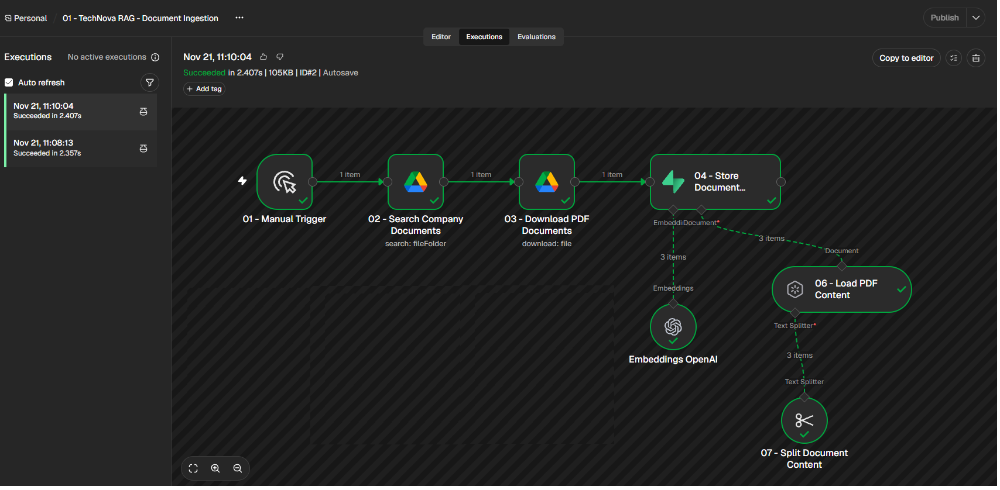
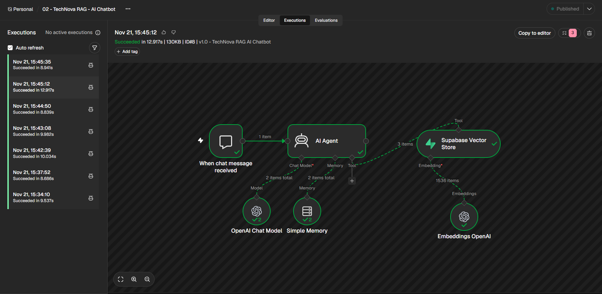

# 🤖 TechNova RAG AI Chatbot

### AI-Powered Company Knowledge Base Assistant Using n8n, OpenAI & Supabase

An end-to-end **Retrieval-Augmented Generation (RAG)** chatbot built with n8n, OpenAI, Supabase, and Google Drive.

The system transforms company PDF documents into a searchable vector knowledge base, allowing users to ask questions and receive relevant, context-aware answers grounded in company information.

**Project Status:** Completed Working Prototype  
**Category:** AI Automation | RAG | AI Agents | n8n  
**Use Case:** Internal Company Knowledge Base & HR Policy Assistant

> **Disclaimer:** TechNova Solutions is a fictional company created for portfolio demonstration purposes. All company policies and HR information used in this project are fictional sample data.

---

## 📌 Project Overview

Organizations often store important information across multiple PDF documents, making it time-consuming for employees to locate specific policies, procedures, and guidelines.

This project demonstrates how AI automation and Retrieval-Augmented Generation (RAG) can simplify internal knowledge retrieval.

Instead of manually searching through documents, employees can interact with an AI chatbot that retrieves relevant information from the company's knowledge base.

### 🎯 Project Objectives

- Automate the processing of company PDF documents.
- Convert document content into vector embeddings.
- Store searchable document embeddings in Supabase.
- Build an AI chatbot capable of answering document-based questions.
- Support conversational follow-up questions.
- Reduce unsupported answers by grounding responses in retrieved information.
- Demonstrate an end-to-end AI automation solution using n8n.

---

## 🛠️ Technology Stack

| Technology | Purpose |
|---|---|
| n8n | Workflow automation and AI orchestration |
| OpenAI GPT-5 mini | AI language model for generating responses |
| OpenAI Embeddings | Convert text into vector representations |
| Supabase | Vector database and semantic document retrieval |
| PostgreSQL / pgvector | Vector similarity search |
| Google Drive | Source storage for company PDF documents |
| n8n AI Agent | Orchestrates chatbot reasoning and knowledge retrieval |
| Simple Memory | Maintains recent conversational context |

---

## 🏗️ System Architecture

The project consists of two connected n8n workflows:

1. **Document Ingestion Workflow** — Processes PDF documents and stores their embeddings in Supabase.
2. **AI Chatbot Workflow** — Retrieves relevant document information and generates grounded responses.

### Workflow 01 — Document Ingestion



**Workflow Process:**

```text
Manual Trigger
      |
      v
Search Company Documents (Google Drive)
      |
      v
Download PDF Documents
      |
      v
Supabase Vector Store (Insert Documents)
      |
      +-- Load PDF Content
      |       |
      |       +-- Recursive Character Text Splitter
      |
      +-- OpenAI Embeddings
      |
      v
Store Document Chunks & Embeddings
```

**How It Works:**

1. The workflow starts through a manual trigger.
2. Google Drive is searched for PDF documents inside the configured company folder.
3. The selected PDF document is downloaded.
4. The document loader extracts the PDF text.
5. A recursive character text splitter divides the content into smaller chunks.
6. OpenAI generates numerical vector embeddings for the document chunks.
7. The chunks, embeddings, and document metadata are stored in Supabase.

**Configuration Details:**

| Setting | Configuration |
|---|---|
| Trigger | Manual |
| Document Source | Google Drive |
| File Type | PDF |
| Document Loader | PDF Loader |
| Text Splitting | Recursive Character Text Splitter |
| Chunk Overlap | 150 characters |
| Embedding Dimensions | 1536 |
| Vector Database | Supabase |
| Database Table | `documents` |
| Current PDF Search Limit | 1 document per execution |

The ingestion workflow also stores document metadata such as filename, source, company, and file identifier.

**Verified Result:** The sample HR policy document was processed into three stored document chunks, each with a corresponding embedding.

---

### Workflow 02 — RAG AI Chatbot



**Workflow Process:**

```text
User Sends Chat Message
          |
          v
       AI Agent
          |
          +---- OpenAI GPT-5 mini
          |
          +---- Simple Memory
          |
          +---- Supabase Vector Store Tool
                       |
                       v
                 OpenAI Embeddings
                       |
                       v
              Semantic Document Search
          |
          v
Generate Document-Grounded Response
          |
          v
Return Answer to User
```

**How It Works:**

1. A user submits a question through the n8n chat interface.
2. The AI Agent receives the question.
3. The agent uses the Supabase Vector Store tool to retrieve relevant company knowledge.
4. Semantic search identifies document chunks related to the user's question.
5. The language model generates an answer using the retrieved information.
6. Simple Memory helps maintain conversational context for follow-up questions.
7. The chatbot returns a clear, natural-language response.

**Configuration Details:**

| Setting | Configuration |
|---|---|
| Chat Trigger | When Chat Message Received |
| AI Agent | n8n AI Agent |
| Language Model | GPT-5 mini |
| Retrieval Tool | Supabase Vector Store |
| Retrieval Mode | Retrieve Documents as Tool |
| Embedding Dimensions | 1536 |
| Database Table | `documents` |
| Memory | Simple Memory |
| Memory Context Window | 10 |

The AI Agent is instructed to prioritize the knowledge base, avoid inventing company policies, and mention source documents when available.

---

## 🧠 What Is Retrieval-Augmented Generation (RAG)?

Retrieval-Augmented Generation is an AI technique that combines information retrieval with language generation.

Instead of relying entirely on the language model's existing knowledge, a RAG system retrieves relevant information from an external knowledge source before generating an answer.

**RAG Process:**

```text
User Question
      |
      v
Convert Question Into Embedding
      |
      v
Search Supabase Vector Database
      |
      v
Retrieve Relevant Document Chunks
      |
      v
AI Generates Grounded Answer
      |
      v
Return Response to User
```

This approach helps the chatbot provide answers based on company-specific documents rather than unsupported assumptions.

---

## 🧪 Testing & Validation

The chatbot was tested using questions based on the fictional TechNova HR policy.

### Test 1 — Sick Leave Entitlement

**User Question:**

> How many days of sick leave are employees entitled to?

**Expected Result:**

The chatbot should retrieve the relevant HR policy and identify the sick leave entitlement.

**Observed Result:**

The chatbot correctly identified the entitlement as **10 sick leave days per calendar year**, based on the fictional HR policy.

**Status:** PASSED

### Test 2 — Follow-Up Question

**User Question:**

> What documentation is required for an absence longer than two consecutive working days?

**Expected Result:**

The chatbot should retrieve the relevant documentation requirement from the HR policy.

**Observed Result:**

The chatbot successfully answered using the available policy information.

**Status:** PASSED

### Test 3 — Missing Information / Unsupported Policy

**User Question:**

> What is TechNova's work-from-home policy?

**Expected Result:**

If the information is not available in the knowledge base, the chatbot should clearly state that it could not find the relevant policy.

**Observed Result:**

The chatbot appropriately indicated that the requested information was not found in the available company documents.

**Status:** PASSED

### Test 4 — Vector Database Verification

Supabase was checked to confirm successful document ingestion and embedding storage.

| Metric | Result |
|---|---|
| Stored Document Chunks | 3 |
| Stored Embeddings | 3 |
| Missing Embeddings | 0 |
| Similarity Search | Successful |

**Status:** PASSED

### Testing Summary

All planned demonstration test scenarios passed.

These results validate the core prototype functionality but do not constitute a comprehensive production security, reliability, or performance assessment.

---

## 📂 Project Structure

```text
01-technova-rag-ai-chatbot/
|
|-- README.md
|
|-- workflows/
|   |-- 01-document-ingestion.json
|   |-- 02-ai-chatbot.json
|
|-- screenshots/
    |-- 01-document-ingestion.png
    |-- 02-ai-chatbot.png
```

### Workflow Files

**01-document-ingestion.json**

Contains the n8n workflow for retrieving PDF documents from Google Drive, processing their content, generating embeddings, and storing document chunks in Supabase.

**02-ai-chatbot.json**

Contains the n8n AI chatbot workflow with an AI Agent, OpenAI language model, conversational memory, and Supabase Vector Store retrieval tool.

The public workflow files are intended as reusable portfolio examples. Service credentials and environment-specific configuration must be supplied separately.

---

## ⚙️ Setup Instructions

To reproduce this project:

1. Create or access an n8n instance.
2. Create a Supabase project and enable the required vector search functionality.
3. Prepare a compatible `documents` table and document similarity search function.
4. Configure Google Drive, Supabase, and OpenAI connections in n8n.
5. Import `01-document-ingestion.json` into n8n.
6. Import `02-ai-chatbot.json` into n8n.
7. Reconnect the required credentials.
8. Configure your own Google Drive document folder.
9. Ensure the embedding dimensions match your Supabase vector database schema.
10. Run the Document Ingestion workflow.
11. Verify that document chunks and embeddings are stored successfully.
12. Activate the AI Chatbot workflow.
13. Test the chatbot using questions based on the uploaded documents.

**Important:** Never commit API keys, access tokens, private credentials, or confidential company documents to a public repository.

---

## 🔒 Security & Current Limitations

- The project uses fictional sample company documents.
- The ingestion workflow currently requires manual execution.
- The configured Google Drive search currently retrieves a maximum of one PDF per execution.
- AI responses depend on the completeness and quality of the knowledge base.
- Retrieval-grounded generation reduces the risk of hallucinations but does not eliminate it.
- The prototype does not yet include production-grade authentication, authorization, monitoring, or automated evaluation.

---

## 🚀 Future Improvements

- Automatic Google Drive document synchronization.
- Batch processing of multiple PDF documents.
- Document update and duplicate detection.
- Enhanced source citations and document traceability.
- Role-based document access control.
- Automated chatbot quality evaluation.
- Improved error handling and monitoring.
- Production deployment with secure access controls.

---

## 💼 Skills Demonstrated

This project demonstrates practical experience in:

- AI workflow automation
- n8n development
- Retrieval-Augmented Generation (RAG)
- AI Agent implementation
- OpenAI API integration
- Vector databases and semantic search
- Supabase and PostgreSQL
- PDF document processing
- Conversational AI and memory
- Workflow debugging and testing
- AI knowledge base development

---

## 📌 Project Summary

**TechNova RAG AI Chatbot** is a working portfolio prototype that demonstrates how AI agents, vector databases, and automation workflows can be combined to create a document-grounded knowledge assistant.

The project highlights an end-to-end implementation, from PDF document ingestion and embedding generation to semantic retrieval and conversational question answering.

**Built with n8n, OpenAI, Supabase, and Google Drive.**

*TechNova Solutions is a fictional company used for educational and portfolio demonstration purposes.*
